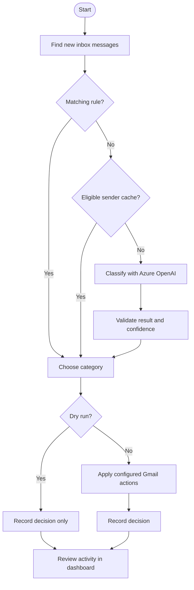

# Postmaster

**An AI-assisted Gmail organizer built for control, resilience, and safe automation.**

[Visit Postmaster](https://postmaster-demo.japaneast.cloudapp.azure.com/) — explore the synthetic demo or apply for the closed beta.

Postmaster classifies incoming email using configurable rules, a learned sender cache, and Azure OpenAI. It can apply Gmail labels and optional actions, with a dashboard for reviewing activity and managing settings.


## Try Postmaster

- [Synthetic demo](https://postmaster-demo.japaneast.cloudapp.azure.com/demo): sign in to explore example data; it does not connect to Gmail.
- [Apply for the closed beta](https://postmaster-demo.japaneast.cloudapp.azure.com/beta/apply): applications are reviewed individually and decisions are not emailed automatically.
- [Beta sign-in](https://postmaster-demo.japaneast.cloudapp.azure.com/beta): for approved accounts. Sign-in and Gmail authorization are separate.
- [Privacy policy](https://postmaster-demo.japaneast.cloudapp.azure.com/privacy) · [Terms of service](https://postmaster-demo.japaneast.cloudapp.azure.com/terms)

The hosted service is experimental. Approval, separate Gmail consent, configuration and an explicit **Start** are required before processing. New beta configurations default to dry run; enabling live mode requires confirmation. Google test-user enrollment may be required. Processing starts stopped after a restart, and in-flight requests may finish after Stop.

## Highlights

- **Hybrid classification:** checks deterministic rules and cached sender decisions before calling the model, reducing unnecessary API requests.
- **Guarded AI output:** treats email as untrusted input, restricts model responses to configured categories with a JSON schema, and routes low-confidence or invalid results to a fallback category.
- **Safe operation:** supports dry runs, configurable actions, an LLM call cap, and explicit Start/Stop controls. The application has no send or delete action.
- **Resilient processing:** persists decisions and Gmail history cursors in SQLite, skips already-processed messages, and retries failures without advancing the cursor prematurely.
- **Quota-aware Gmail access:** limits request usage and backs off when Gmail throttles requests.
- **Dashboard:** inspect activity, edit categories and rules, adjust settings, and control processing. The local single-user dashboard also previews sample messages.

## How it works



1. **Discover:** scan the configured inbox lookback, then use Gmail history to find new messages.
2. **Classify:** check rules first, then the sender cache. Only messages without a match need the model.
3. **Decide:** validate the model's category and confidence; use a fallback when the result is uncertain or invalid.
4. **Act:** dry run records decisions without changing Gmail. In confirmed live mode, apply the category's configured labels and actions.
5. **Review:** inspect decisions and processing activity in the dashboard while Postmaster continues checking for new mail.

Azure content-filter blocks are filed separately under **AI/Content Filtered** (with your configured label prefix), without archiving or marking the message read. These decisions are treated as processed, not automatically retried. Other Azure errors remain retryable. The ID `content_filtered` and label `Content Filtered` are reserved for this built-in outcome.

## Local single-user setup

These instructions run a separate local instance, not the hosted beta. For private VM deployment, backups and monitoring, see the [Azure operations runbook](docs/azure-operations.md).

### Prerequisites

- Docker and Docker Compose
- A Google Cloud project with the Gmail API enabled and an OAuth client. Place the downloaded client JSON at `secrets/credentials.json`; configure the OAuth consent screen and test users as needed.
- An Azure OpenAI endpoint, API key, and deployment name, or the built-in mock classifier.

Postmaster requests the Gmail `gmail.modify` OAuth scope. Mock mode avoids Azure calls but still requires Gmail credentials to process email.

### Setup

1. Create the environment file and configure Azure, or set `POSTMASTER_MOCK=1`:

   ```bash
   cp .env.example .env
   ```

2. Put your Google OAuth client in `secrets/credentials.json`, then authorize Gmail:

   ```bash
   docker compose run --rm --service-ports auth
   ```

   Open the URL printed by the command and approve access. The token is saved to `secrets/token.json`.

3. If `config/categories.yaml` does not exist, copy `config/categories.default.yaml` to that path. Review the configuration and set `settings.dry_run: true` before the first run. Do not overwrite an existing configuration. The shipped default uses a 365-day lookback; existing configurations may differ.

4. Build and start the containers:

   ```bash
   docker compose up -d --build
   ```

5. Open [http://localhost:8080](http://localhost:8080) and press **Start**. Review the dry-run decisions before setting `dry_run: false` in the UI or live configuration. Configuration changes take effect on the next poll cycle.

Postmaster starts **stopped** after each container restart. **Start** scans the configured lookback and skips processed messages; **Stop** finishes in-flight work before pausing.

## Configuration

For the local single-user app, categories, rules, and settings live in `config/categories.yaml` and can also be edited in the dashboard. The hosted beta stores settings per account instead. Categories define labels, descriptions, examples, actions, and optional unread-only eligibility. Settings include the confidence threshold, fallback category, poll interval, lookback, body length, and daily LLM call cap.

Supported actions are `label`, `star`, `mark_read`, and `archive`. Choose actions carefully: live mode can change read and inbox status. Saving from the local UI rewrites the live YAML, preserves the previous version as `categories.yaml.bak`, and removes YAML comments. The shipped default is not changed.

## Commands

| Command                                        | Purpose                                                           |
| ---------------------------------------------- | ----------------------------------------------------------------- |
| `docker compose logs -f`                       | Follow application logs                                           |
| `docker compose run --rm test`                 | Run tests                                                         |
| `docker compose run --rm ci`                   | Run lint, format check, typecheck, coverage, config check, build  |
| `docker compose run --rm undo <ISO timestamp>` | Undo recorded labels and configured category actions since a time |
| `docker compose run --rm eval --mock`          | Evaluate the mock classifier against a local dataset              |

The undo command modifies Gmail: it removes recorded labels and may restore inbox or unread status based on the current category configuration. It is not a snapshot of the message's original state.

For evaluation, create `eval/dataset.jsonl` with one synthetic example per line, for example:

```json
{
  "from": "orders@example.com",
  "subject": "Your order shipped",
  "body": "Your package is on its way.",
  "label": "receipts"
}
```

The report includes accuracy and a confusion matrix. Omit `--mock` to evaluate the configured Azure deployment.

To check the evaluation path without real email or paid model calls, use the included synthetic examples:

```bash
docker compose run --rm -e EVAL_DATASET=eval/synthetic.jsonl -e CONFIG_PATH=config/categories.default.yaml eval --mock
```

This is a smoke test, not a measure of model accuracy. For integration checks, `docker compose run --rm ci npx tsx scripts/smoke-azure.ts` classifies one synthetic message using Azure (and may incur charges). `docker compose run --rm auth npx tsx scripts/smoke-gmail.ts` checks Gmail authorization via the profile endpoint without reading or changing messages; token refresh may update `secrets/token.json`.

## Architecture and testing

The application separates the Gmail client, classifier, pipeline, and persistent state behind testable interfaces. In the local single-user setup, the dashboard and poller run as separate containers and share local state. The hosted beta uses separate account-scoped access, settings and processing controls. Configuration is validated with Zod; logs are structured with Pino.

Vitest exercises the pipeline offline using fake mail and classifier implementations, with mocked Gmail and Azure clients. Tests cover dry-run behavior, idempotency, retry and quota handling, call limits, configuration validation, and model output validation.

## Privacy and security

- When model classification is needed, sender, subject, date, unsubscribe-header presence and a limited cleaned message body may be sent to Azure OpenAI, including in dry run. Attachments are not sent to the model. The hosted beta uses Global Standard processing, which may occur outside the VM region. See the [privacy policy](https://postmaster-demo.japaneast.cloudapp.azure.com/privacy).
- The hosted beta is experimental; security isolation, backups, recovery and monitoring are not fully hardened. Do not assume Google verification or compliance is complete.
- The local single-user dashboard binds to `127.0.0.1` and has no login. Do not expose it publicly.
- Keep `.env`, `secrets/`, `data/`, and real email datasets private. Use synthetic examples in tests and never commit credentials or real email.
