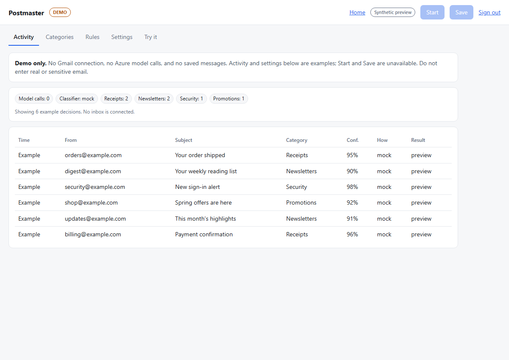

# Architecture

Postmaster is an experimental closed beta, not a production-ready service. The public site, public synthetic demo and real Gmail beta are separate experiences.



The screenshot and [narrow-screen view](screenshots/synthetic-demo-mobile.png) are from the local synthetic demo: their messages, categories and decisions are examples, and it does not connect to Gmail or Azure OpenAI. The beta dashboard is separate.

## Hosted beta

```text
Browser -> HTTPS proxy -> beta server -> account-scoped SQLite state
                            |              ^
                            |          scheduler / worker
                            |              |
                            |       Gmail API -> rules -> cache -> Azure OpenAI
                            |                           -> decision / Gmail actions
                            +-> separate notification sender -> operator's Gmail

Browser -> HTTPS proxy -> public synthetic demo (no Gmail or Azure)
```

- **Identity and access:** Google sign-in identifies the account. An admin reviews unverified email applications; the first matching Google-authoritative identity binds an approved application. Gmail authorization is a separate consent flow. Approval, configuration and an explicit Start are required before processing.
- **Processing:** A scheduled worker reads the configured lookback and then Gmail history, checks rules and eligible sender cache entries, and invokes Azure OpenAI only when needed. Invalid or low-confidence classifications use a fallback. Decisions and usage are account-scoped in SQLite. Dry run records decisions without modifying Gmail; live mode requires confirmation and can apply configured labels and actions.
- **Notifications:** When explicitly configured, a distinct send-only OAuth grant for the operator's account sends application alerts and approval or denial notices. Application addresses are unverified. Notifications are queued separately from mailbox processing; delivery is not guaranteed and retries can duplicate messages. See [notification setup](beta-notifications.md).
- **Data and keys:** SQLite holds applications, settings, decisions and operational state; Gmail tokens are encrypted using a pinned Azure Key Vault key. The VM and its workloads remain a security boundary. Backups, recovery, managed-identity isolation and monitoring are not fully hardened.
- **Local single-user app:** The local dashboard and poller share a separate state database and YAML configuration. Its unauthenticated dashboard must stay on loopback. It is not the hosted beta.

Gmail calls and SQLite commits are not atomic. Stop and revocation prevent new work but cannot recall requests already in flight. A restart stops beta processing until the user explicitly starts it again. See the [privacy policy](https://postmaster-demo.japaneast.cloudapp.azure.com/privacy) for data handling and the [backup](beta-backup.md) and [recovery](beta-revocation-recovery.md) runbooks for operational limitations.

## Release and smoke tests

Full local CI exercises synthetic inputs, not real Google authorization or real mailbox behavior. Existing manual smoke scripts check Azure classification with synthetic input and Gmail profile authorization with a separate account; see the README. A real end-to-end smoke test requires an explicitly authorized throwaway account and careful cleanup, and remains unverified. Automated image publishing and a remotely triggered smoke test are deferred until runner credentials, isolation, permissions and release controls are reviewed; no GitHub configuration is changed here.
